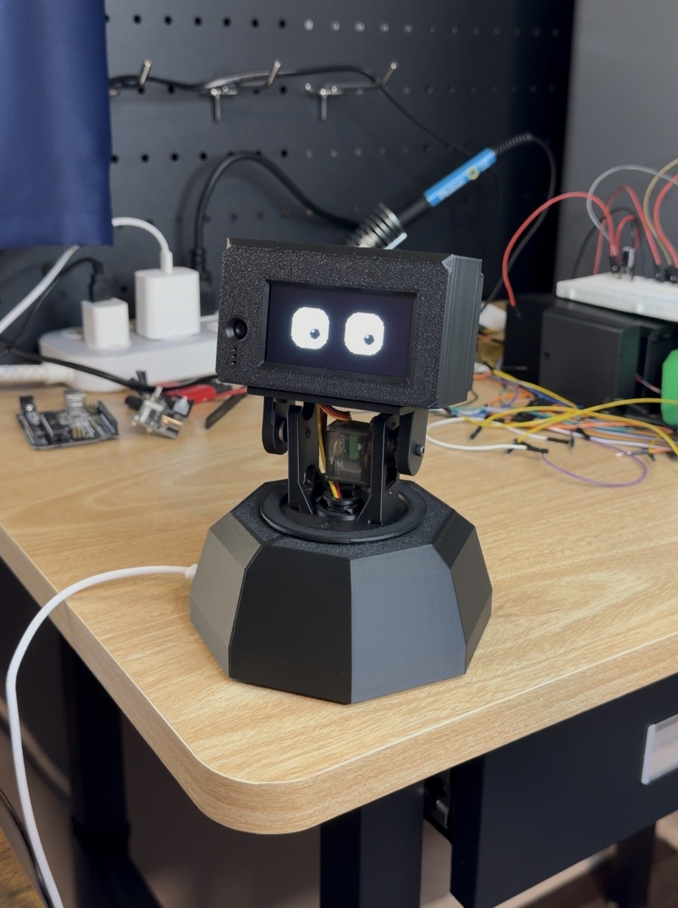

# desk-robot

A small desk robot with a face, a voice, and a camera. Say "hey Rocky" and it
turns its head, looks at you, and answers out loud in character. The body is
a $24 microcontroller with an OLED screen on a pan-tilt neck. The brain is a
Python program on your computer that does speech-to-text, asks a language model,
and speaks the reply through the robot's speaker.

<p align="center"></p>

## Versions

**This README is for V2**, the current robot: a 3D-printed neck and head, a
bigger screen, and the speaker in the head. **V1**, the first build with an
off-the-shelf pan-tilt bracket and a breadboard (no 3D printing), is frozen
as the [v1.0 release](https://github.com/cgro00/desk-robot/releases/tag/v1.0):
its README and code there are a permanent snapshot of that build. Each video
matches the version it was made with. [CHANGELOG.md](CHANGELOG.md) lists what
changed between versions.

Out of the box it is **Rocky**, the Eridian engineer from *Project Hail
Mary*: short sentences, "question" and "answer", "amaze", and constant
worry about whether you have slept. Everything about him is yours to change.
See [Make it your own](#make-it-your-own).

**What it can do**

- Wake on its name, listen, and answer with a spoken reply in a cloned voice.
- Show twelve expressions on its face, in a look you pick or design, blink,
  and doze off when ignored.
- Turn and nod its head, follow your face, and look where you ask.
- See through its camera and tell you what is there, honestly, and notice
  your face (smiling, looking at him) and a wave.
- Decide when you have finished talking, the way a person does, instead of
  waiting for a fixed pause.
- Keep you off your phone during a focus session, and say something about
  it, in character, when you slip.

**How it is put together**

```
┌──────────────── the robot (XIAO ESP32S3 Sense) ───────────────┐
│  OLED face · pan/tilt servos · camera · mic · amp + speaker   │
└───────────────────────────┬───────────────────────────────────┘
                            │ WiFi (WebSocket)
┌───────────────────────────┴───────────────────────────────────┐
│  brain server (Python, on your computer)                      │
│  wake word → speech-to-text → language model → text-to-speech │
│  plus face tracking, emotions, and head movements             │
└───────────────────────────────────────────────────────────────┘
```

The firmware is deliberately simple: it draws the face, moves the servos,
and streams audio and camera frames. All the judgement lives in `server/`.
Nothing is billed while the robot is idle.

## Contents

1. [What you need](#what-you-need)
2. [Build the body](#build-the-body)
3. [Flash the firmware and test over USB](#flash-the-firmware-and-test-over-usb)
4. [Set up the brain on your computer](#set-up-the-brain-on-your-computer)
5. [Connect the robot to the brain](#connect-the-robot-to-the-brain)
6. [Living with Rocky](#living-with-rocky)
7. [Make it your own](#make-it-your-own)
8. [Troubleshooting](#troubleshooting)
9. [How it works](#how-it-works)
10. [Privacy and security](#privacy-and-security)
11. [Credits and license](#credits-and-license)

## What you need

**Parts (V2).** Roughly $100, plus a soldering iron and a 3D printer.

| Part | Notes |
| --- | --- |
| Seeed XIAO ESP32S3 **Sense** | The Sense version has the camera and microphone built in. The little U.FL antenna in the box is required for WiFi. |
| 2.42" SSD1309 I2C OLED, 128x64 | The face (HiLetgo's board, 70 x 48 mm). V1's 1.3" SH1106 also works: set `OLED_SSD1309_242` to 0 in `firmware/include/config.h`. |
| 2 x MG90S metal-gear servos | Pan and tilt. |
| The printed neck and head | Base and dome, turntable (with the 30-tooth pan gear built in), the 38-tooth pinion, head plate, head shell, and its face and back lids. The print files are in the hardware bundle on my website. |
| MAX98357A I2S amplifier board | In the head. The $3 clones work. |
| Dayton Audio CE32A-8 speaker | 1¼", 8 Ω, 2 W, on the head's back lid. The voice is tuned for it; another small 4–8 Ω speaker works, see [Change the voice](#change-the-voice) to retune. |
| USB-C breakout board | Power comes in at the base. |
| 470 µF 10 V electrolytic capacitor, 1N5817 Schottky diode | Keep the servos from browning out the board, and the XIAO's own USB port from feeding them. Not optional. |
| The head and base boards, or perfboard | The board files are in the hardware bundle. Perfboard works too: same connections, see [Wire it up](#wire-it-up). |
| 2 x 1x8 (or 1x7) female pin headers, 1 x 3-pin male header | Sockets for the head board to plug onto the XIAO's pins; the pan servo's plug on the base board. |
| Stranded silicone wire, 24–26 AWG: brown, red, orange | The three neck wires from the base board up the hollow post to the head (about 30 cm each, cut to length at the end). |
| 22 AWG wire, red and black; 9 female jumper wires | Power from the USB-C breakout to the base board; the screen's and the amp's wires (jumper ends push onto their pins). |
| JST-PH 2.0 2-pin lead pair | Speaker to amp, so the back lid comes off without tools. |
| M2 and M3 screws, M3 heat-set inserts | For the screen, the neck, and the base. |
| 5 V, 2 A or better USB-C power supply | A laptop port is fine for flashing, not for running servos and speaker. |
| 4 rubber bumpers, 10 x 3 mm (optional) | In the recesses under the base, so he stays put on the desk. |

**On the computer side.**

- A Mac, Windows PC, or Linux machine on the same WiFi as the robot. It was
  built and tested on an Apple Silicon Mac. Windows and Linux use the same
  code except for the built-in fallback voice and speaker playback, which
  have their own paths that nobody has run yet. If you're the first, say how
  it went. On Linux, install `espeak-ng` for the fallback voice.
- Python 3.13, which is what this was built and tested with.
- PlatformIO for flashing the firmware (installed below).
- A language-model API key. Any one of these works:
  - **OpenRouter** (the default): one key, any model, easy to switch.
  - **Anthropic**: use a Claude model directly.
  - **OpenAI**: use a GPT model directly.
- Optionally a **Fish Audio** key for the cloned voice. Without it Rocky
  speaks with your computer's built-in voice, which is fine for getting
  started.
- Optionally an **OpenAI** key for [focus mode](#focus-mode), even if your
  language model is elsewhere. It costs about 3 cents a 25-minute session.

**Skills.** Basic through-hole soldering, and the patience to read
[Wire it up](#wire-it-up) before powering anything on.

## Build the body

The **hardware bundle** on my website has everything for the printed body: the
print files, the board files, a wiring diagram and an illustrated step-by-step
assembly guide. This section is enough to wire it up yourself, on the custom
boards or on perfboard.

The pan servo, the power input and the base board sit in the base. The XIAO,
the screen, the amp, the speaker and the head board ride in the head, with
the tilt servo under it. Three wires up the hollow post join the two. The
camera and microphone are on the Sense board already: no wiring for them.

### Power rules

1. **Everything shares ground.**
2. **Servos and the amp get 5 V, never 3.3 V.** The XIAO's 3V3 pin can't
   carry a servo and the board will brown out. Only the screen runs from 3V3.
3. **The 470 µF capacitor sits across 5 V and ground on the base board.**
   Long leg to +, striped side to ground. Without it the servos starting up
   brown out the camera.
4. **The XIAO gets its 5 V through the 1N5817 diode** (band toward the XIAO),
   so its own USB-C port, used for flashing, can't feed the servos.
5. Use a **5 V, 2 A (or better) USB-C supply** in the base.

### Wire it up

Servo colors: **brown = ground (G), red = 5 V (V), orange = signal (S).**
Keep the same colors for your own wires and every joint is easy to check.

**Base board** (in the tray at the front of the base)

| From | To |
| --- | --- |
| USB-C breakout VBUS (+) | 5V IN (red wire) |
| USB-C breakout GND (−) | GND IN (black wire) |
| 470 µF capacitor | across 5 V and ground (long leg in the + hole) |
| Pan servo plug | PAN header: brown on G |
| Neck wires G / V / S | NECK: brown, red, orange. Their other ends go up the post to the head board |

PAN's and NECK's signal pins are joined on the board: the pan servo's signal
comes down the neck from the XIAO.

**Head board** (plugs onto the XIAO's pins from behind, through two female
sockets; seen from the back of the head the XIAO's 5V / GND / 3V3 row is on
top and its USB-C end on the right)

| From | To |
| --- | --- |
| NECK G / V / S | ground / +5 V in / XIAO **D3** (pan signal) |
| TILT G / V / S | tilt servo brown / red / orange; signal to XIAO **D8** |
| +5 V in | 1N5817 diode, band to the XIAO's **5V** pin. Also the amp's VIN |
| Ground | the amp's GND |
| XIAO **3V3** / GND | screen VCC / GND |
| XIAO **D4** / **D5** | screen SDA / SCL |
| XIAO **D0** / **D1** / **D2** | amp BCLK / LRC / DIN |
| Amp + / − | speaker + / − (through the JST-PH lead) |

The amp's GAIN and SD pins stay unconnected. Match the names printed on your
screen and amp: pin order differs between makers.

**Order matters for the neck wires.** They pass through the turntable's
center hole, the head plate's slot and the head's floor on their way up, so
solder them to the base board first and to the head board last, once the
neck and head are assembled. The tilt servo's lead goes up through the same
two slots. Leave a loose 3–4 cm loop above the post so the head can pan.

**Before the first power-up**, with a multimeter on beep:

- No beep between 5 V and ground, on either board.
- The head board's 5V socket beeps to the diode's banded end.
- The XIAO is the right way round: its GND pin (top row, second from the
  USB-C end, seen from the back) beeps to the metal shell of its USB-C port.

**Centering the servos** before the gears and horns go on is what makes the
head face forward and sit level at home. The firmware's assembly mode does
it (`assembly on` in the serial console, or the XIAO's BOOT button within
5 seconds of power-up): see [`docs/wiring.md`](docs/wiring.md#first-power-up).

## Flash the firmware and test over USB

Do this before WiFi. It proves the face and the neck work.

1. Install PlatformIO, either as the VS Code extension or from the terminal:

   ```bash
   brew install platformio
   ```

2. Plug the XIAO in over USB-C, then build and flash:

   ```bash
   cd firmware
   pio run -t upload
   pio device monitor        # serial console at 115200
   ```

3. The screen starts on the clock (it waits for WiFi, so it shows
   `--:--`). In the serial console, try:

   ```
   help                 list commands
   sleep off            wake him: the face replaces the clock
   emo happy            change the face (twelve: neutral, happy, sad, angry, surprised, sleepy,
                        thinking, curious, skeptical, excited, love, confused)
   demo on              cycle through the faces on his own
   pan 30               turn the head, -95 (his left)..95 (his right), 0 = center
   tilt 15              nod the head, -85 (down)..85 (up), 0 = level
   center               head straight ahead and level
   assembly on          both servos to centre and hold, for fitting the gear and horn
   raw tilt 20          calibration move that ignores the limits (watch it!)
   ```

4. Check the head's manners, with small moves first: `tilt 15` must look
   up and `pan 30` must turn to his right (your left, facing him). If not,
   flip `TILT_INVERT` or `PAN_INVERT` in `firmware/include/config.h`. If the
   head is not straight or level at 0, adjust `PAN_TRIM_DEG` and
   `TILT_TRIM_DEG` a few degrees at a time. Re-flash after each change.
   [`docs/wiring.md`](docs/wiring.md#first-power-up) has the details.

Without a `secrets.h` file the firmware stays in this USB-only mode, which
is useful whenever you want to test the body alone.

## Set up the brain on your computer

The brain works without the robot: it uses your computer's microphone and
speaker until the robot connects. Get it talking first.

```bash
cd server
python3 -m venv .venv
source .venv/bin/activate          # Windows: .venv\Scripts\activate
pip install -r requirements.txt
cp .env.example .env               # Windows: copy .env.example .env
```

Open `server/.env` and fill in:

- `LLM_API_KEY`: your OpenRouter key. (For Anthropic or OpenAI instead, see
  [Change the model or provider](#change-the-model-or-provider).)
- `HUMAN_NAME`: what Rocky should call you.
- `ROBOT_TOKEN`: any random string. The robot will need the same one. Make
  one with `python3 -c "import secrets; print(secrets.token_hex(16))"`.
- `FISH_AUDIO_API_KEY`: optional, for the cloned voice.
- `OPENAI_API_KEY`: optional, for [focus mode](#focus-mode).

Then start the dashboard, from the `server` folder:

```bash
.venv/bin/python launcher.py      # Windows: .venv\Scripts\python launcher.py
```

and open <http://localhost:8766/>. Press **Start server** to start the brain.
From then on the dashboard's header controls it: **Restart** and **Stop**
appear once it's running, and **Start server** again after you stop it. The
dashboard itself keeps running while the brain is stopped, so you never need
the terminal for this; leave the launcher's terminal window open, though,
since closing it stops the dashboard too.
(You can also run the brain on its own with `python -m brain.main` with the
venv active; the launcher just does that for you and keeps the dashboard up
while the brain is stopped.)

The first run downloads about 160 MB of speech models into `~/.cache`
(Whisper from Hugging Face, the two turn-detection models from GitHub and
Hugging Face, all pinned to a fixed version). macOS will ask once to let
your terminal use the microphone; on Windows, check that microphone access
for desktop apps is on in Privacy settings. Say **"hey Rocky, what is a
weekend?"** and he should answer through your computer's speaker. You can
also type `ask what is a weekend?` into the server console (the dashboard's
Log tab has one).

To have the dashboard there whenever you log in, run
`server/install_launcher.sh` once (macOS; `--uninstall` removes it, and
`--start-brain` also starts the brain with it).

### The dashboard

<http://localhost:8766/> has five tabs, and only answers this computer:

- **Live**: what Rocky sees and hears, the last exchange, and buttons for
  his head, face, sleep, words to say, and a focus session. **Start server**, **Restart** and
  **Stop** for the brain are in the header, on every tab. (If you started the
  brain yourself with `python -m brain.main`, the header shows it running but
  leaves Stop and Restart to that terminal.)
- **Settings**: everything you would otherwise edit in a file, saved in
  `server/settings.json` (git-ignored) and applied straight away. The clock
  screen (12 or 24 hour, date order, time zone), the weather (search for
  your town; °F or °C; high and low or sunrise and sunset), the screen
  (brightness, dim or off at night), your name, how long he stays awake,
  speaker volume, where his voice plays, the camera rotation, and an
  Advanced section with the listening and voice tuning. Settings work with
  the server stopped; the robot gets them the next time it connects.
- **Personalities**: who the robot is. Rocky is built in and the default;
  make others here without touching code. See
  [Add a personality](#add-a-personality).
- **Faces**: face packs, the look of Rocky's eyes. Every face in a pack is
  shown moving the way it will on the robot; pick a pack with **Use this
  pack**, or duplicate one and change any face with sliders (both eyes or
  one at a time, flourishes like blush, tears, hearts or a "?"), watching
  it on the robot as you go. See [Change the face](#change-the-face).
- **Log**: the server's output, and a box for console commands. It is kept
  in memory only, and speech Rocky heard but ignored shows without its
  words.

The brain also serves the Live part on <http://localhost:8767/> by itself,
without settings or server buttons.

## Connect the robot to the brain

1. Find your computer's address on your WiFi:

   ```bash
   ipconfig getifaddr en0     # macOS
   ipconfig                   # Windows: the IPv4 address of your WiFi adapter
   hostname -I                # Linux
   ```

   Your router can usually pin the computer to a fixed address so this does
   not change.

2. Copy `firmware/include/secrets.h.example` to `secrets.h` in the same
   folder and fill in your WiFi name and password, that address, and
   the same `ROBOT_TOKEN` you put in `server/.env`. The ESP32 only sees
   **2.4 GHz** networks.

3. Flash again with `pio run -t upload`. The serial console shows
   `wifi: connected` and then `brain: connected` once the server is running.

From then on the server listens through the robot's microphone and speaks
through the robot's speaker whenever the robot is connected, and falls back
to your computer when it is not. The robot can now live on a wall supply
away from the computer.

## Living with Rocky

| Say | What happens |
| --- | --- |
| "hey Rocky" | He wakes, looks up, and waits for your question. His name alone, without "hey", does not wake him. |
| anything, while he is awake | He answers. No need to repeat his name for about a minute. |
| "Rocky, turn your head left" / "look up" | He turns his head and says so. Nothing about the room unless you ask. |
| "Rocky, look at the door" / "what's over there?" | He turns his head, takes a fresh picture, and tells you what he sees. |
| "Rocky, dance!" | One of his four routines at random (groove, robot, sprinkler, disco), about 10 seconds of neck moves on a beat. The dashboard's Head card has a Dance button too. |
| "what do you see?" | He describes the current camera frame, and only what is actually in it. |
| "track me" / "stop tracking" | His head follows your face, or stops. |
| "Rocky, sleep" / "goodnight" | He says goodnight and stops listening until you say his name. His screen shows the sleep face for a few seconds, then the clock. |
| "Rocky, help me focus for 25 minutes" | A [focus session](#focus-mode): he answers nothing until it ends, and only speaks up when you pick up your phone. "Hey Rocky, stop focus" ends it early. |

He decides you are finished the way a person does. A small model listens to
how your sentence ends; if you sound done he answers about a third of a
second later, and if you trail off he waits. His first sentence is spoken
while the rest is still being written. If you start talking again before he
speaks, he drops the reply and answers the whole thing once. Once he is
speaking he finishes the line, because his microphone is muted while his
own voice plays.

While he talks his head moves a little with how he feels: a happy bounce, a
surprised pull-back, a sad droop, a curious lean, a confused look from side to
side, then a small nod or drift every few seconds until he finishes (with
pauses long enough for the servos to go quiet), and a glance up while he
works out a reply. He keeps still while asleep, while following your face,
and once he turns to look at something: the picture stays sharp, and he keeps
looking at it, servos quiet, while he tells you about it. The
moves are in `server/brain/body.py`; switch them off with *Body language* in
the dashboard's Rocky card.

Server console commands, for when talking is inconvenient:

```
ask <question>       talk to Rocky from the keyboard
say <text>           speak exactly this
volume 0.5           speaker volume, 0 to 1
listen               toggle the microphone
mic                  three-second level meter
track on|off         face tracking
emo surprised        push a face
gesture curious      try an emotion's body language
pan 20 / tilt -20    move the head
status               what is connected
```

Every reply prints a `timing` line so you can see where the seconds go.

### What Rocky sees

While he's awake, every question goes to the model with a picture from his
camera, so he knows what you're doing without being asked to look. When the
question is about seeing ("what am I holding?"), the picture is a sharp
1024×768 still that the robot takes while you're still talking, so it costs
no time. The stream itself is 640×480 for face tracking and the models
below (320×240 in Settings > Vision if your WiFi is weak).

What is in the room, what you are holding, a label or a screen: the model
reads all of that from the picture itself. Two small models on your computer
also watch the stream a few times a second:

- **Faces**: [MediaPipe](https://ai.google.dev/edge/mediapipe) face
  landmarks: smiling, eyes closed, looking at him or away, roughly how far.
  With a question about seeing he gets a one-line note next to the picture
  ("one person about 1 m away, looking at you, smiling").
- **Hands**: MediaPipe's hand model, watching for a wave. A wave wakes him
  up.

The dashboard's Live tab shows what they notice (with boxes on the camera
view), and Settings > Vision turns them on or off. The models (about 12 MB)
download on the first start, pinned and checksummed.

### The clock screen

While Rocky is asleep (and from the moment he powers up) his screen shows
the time, the date, and the weather. "Hey Rocky" switches to his face; when
he dozes off, or you send him to sleep, he shows the sleep face for about
five seconds and goes back to the clock.

The robot runs the clock itself: internet time over WiFi, and weather from
[Open-Meteo](https://open-meteo.com) (free, no account or key), so it keeps
going with the computer off. Set your town in the dashboard's Settings tab;
until you do, the clock shows no weather. The robot keeps its settings in
flash, so a power cut doesn't lose them. Against OLED burn-in the clock
shifts a pixel or two every minute, and by default it dims from 23:00 to
07:00 (or turns the screen off, if you choose that).

Instead of the clock, Settings > Screen > "While he sleeps" can put a game
on his screen that plays itself and never loses, with the time in a corner:
**Pong** (the paddles never miss), **Tetris** (a small built-in player
stacks the pieces; if the stack ever nears the top the board wipes and a new
game starts) or **Frogger** (the frog waits for gaps in the traffic and rides
the logs home, a little faster each level). They run on the robot too.

Or pick **Look around**: his neutral face stays up and his head roams the
room by itself, a new spot every few seconds across his whole pan range and
half his tilt range, both servos moving together, his eyes going first. He is
still asleep (listening only for "hey Rocky", sending no pictures), and at
night he centres his head and shows the clock instead. Looks near level last
longer, because that is where the tilt servo can rest quietly.

### Let him use your computer

Off until you switch it on in Settings > Computer ("Let Rocky use my
computer"); the dashboard remembers your choice. Then:

- **"Look up an Arduino on Amazon"**: searches Google, Google Images,
  Amazon, YouTube, Maps, Wikipedia, GitHub, eBay or Reddit.
- **"Open YouTube"**: those sites, Gmail, and bookmarks you add.
- **"Open Spotify"**: apps on the list in the same card.
- **"Play Mr. Blue Sky"**, **"put on some Daft Punk"**: finds a song,
  artist, album or playlist on Spotify and plays it (needs a Spotify key,
  below). **"What's playing?"**, **"pause"**, **"next song"** work without one,
  in Spotify or Apple Music.
- **"Turn the volume down"**: this computer's sound (not on an audio
  interface, whose volume macOS can't set).
- **"Run Lights off"**: Apple Shortcuts you pick from the list. He asks
  first, and runs it after you say yes.

Searches and sites work on any computer. Apps, music, volume and Shortcuts
need a Mac for now (on Windows or Linux the server doesn't offer them to
him). [docs/computer-control-windows.md](docs/computer-control-windows.md) has
ideas for adding them on Windows.

He can't type, click, log in or buy anything, and every address and
command is built by the server from those lists, never by the model. At
most 3 actions per question and 8 a minute. Each one shows up on the
dashboard and in the log. Opening a page costs no extra AI call, so it's as
fast and cheap as a normal answer. The first music command makes macOS
ask whether the server may control Spotify or Music: allow it.

**Spotify key** (for playing by name; Spotify only gives these to Premium
accounts):

1. Sign in at [developer.spotify.com/dashboard](https://developer.spotify.com/dashboard)
   and click **Create app**. Any name and description; Redirect URI
   `http://127.0.0.1:8766/`; tick **Web API**; save.
2. Open the app's **Settings** and copy the **Client ID** and **Client
   secret** into `server/.env` as `SPOTIFY_CLIENT_ID` and
   `SPOTIFY_CLIENT_SECRET`. Outside the US, set `SPOTIFY_MARKET` to your
   two-letter country code.
3. Restart the server (**Restart** in the dashboard's header). Settings >
   Computer says "Key found".

Without a key he opens Spotify's search for you to pick from.

### Focus mode

Say **"Rocky, help me focus for 25 minutes"**, or pick a length on the
dashboard's **Focus** card (Live tab) and press **Start focus**. For that
long he keeps an eye on you, and when you pick up your phone he turns to you
and tells you off. A glance at a notification is fine: he only reacts after
about 8 seconds on it. Keep scrolling and he says it again every 30 seconds,
more dramatically each time. Put it down and he approves, and when the time
is up he tells you how it went. His words come from the language model in his
own character, so every personality does it in its own way.

**During a session he answers nothing he hears**, "hey Rocky" included, so
you can talk to people around you or to yourself. The one exception is
**"hey Rocky, stop focus"**, which ends it early. So does **End session** on
the dashboard. His face stays up the whole time instead of dozing, and the
Focus card shows the time left and what the last check saw.

How he spots the phone: every 3 seconds the newest camera frame goes to
OpenAI's [Decisions API](https://developers.openai.com/api/docs/guides/decisions) with one
yes-or-no question, "is this person using a phone?". Instead of writing an
answer it sends back a probability, in under a second, and he reacts when
that stays at 80% or more for three checks in a row. The question is in
`server/brain/focus.py`, and the thresholds are the `FOCUS_` settings in
`server/brain/config.py`.

**OpenAI key** (separate from your language-model key, even if that's
OpenAI too):

1. Sign in at [platform.openai.com](https://platform.openai.com) and add a
   payment method under **Billing**. There is no free tier for this API.
   A few dollars of credit lasts a long time: a frame is about 640 tokens,
   so a 25-minute session costs about 3 cents. A monthly budget limit on
   the project is a good idea.
2. Create a key under **API keys** and put it in `server/.env` as
   `OPENAI_API_KEY`.
3. Restart the server (**Restart** in the dashboard's header). The Focus
   card's **Start focus** button works once the key is found.

Without the key the Focus card says so, and he doesn't offer focus sessions
by voice. The robot has to be connected, since he watches through its camera.

## Make it your own

Everything below is a dashboard setting or a one-file edit. None of it
needs the robot plugged in, so you can tune the character with `ask` in the
server console before the body is even built.

### Add a personality

The dashboard's Personalities tab makes a whole new character without
touching code. Press **New personality**, then:

1. Give it a name. The name is also the wake word ("hey Juniper"), so two
   or three syllables that aren't an everyday word work best.
2. Pick a voice on [Fish Audio](https://fish.audio) and paste its ID (or
   the whole address of its page). **Test voice** plays a sample on this
   computer.
3. Pick the voice model. **Drama 3** acts: the personality can sigh, laugh
   or whisper, and Drama 3 performs those directions instead of reading
   them out. **S2.1 Pro** is Fish's standard model, the one Rocky uses: a
   steady, natural read with no acting directions. On Fish's API, Drama 3
   costs $50 per million bytes of text ($10 on launch sale until November
   12, 2026) and S2.1 Pro $15: about $7.50 and $2.25 per thousand replies.
4. Describe the personality in a sentence or two and press **Write it for
   me**. Your language model writes the personality, example replies, the
   few lines said without thinking, and the ways speech-to-text tends to
   mishear the name. Edit anything, then **Save and use**.

Switching personalities restarts the server, so the conversation starts
fresh. Rocky is always one click away. Yours are saved in
`server/characters/` (git-ignored); **Export** one to share it and
**Import** to load someone else's. Each one brings its own name, voice and
wake words; the robot's rules (short spoken replies, honesty about the
camera, the head, the face) are added for every personality.

A personality's text tells the language model how to behave, so read one
from someone else before you use it, the way you would a script. With
**Let Rocky use my computer** on, it could ask him to open sites or apps
from your lists; Shortcuts still need you to answer yes to "Run <name>?",
said out loud by name.

### Rename the robot

`ROBOT_NAME` in `server/brain/config.py`. The wake word becomes "hey
<name>" and the sleep phrases and speech-to-text hint follow automatically.
Update `WAKE_PHRASES` in the same file with the ways speech-to-text tends
to mishear the new name (run `python -m brain.main` in a terminal, say it
a few times, and watch the `heard, ignoring` lines; the dashboard's Log tab
hides their words). The
character file still introduces itself as Rocky, so edit
`server/brain/personality.py` too, or you have a robot called Bolt who
insists he is Rocky.

### Change the character

`server/brain/personality.py` is the whole personality: one system prompt
that pins down who he is and how he talks, plus a few canned lines for
waking, sleeping, and tracking. To make a different character, rewrite the
prompt. The parts worth keeping are the rules about being honest with the
camera, the emotion tag at the start of every reply, and the sentence
limit, because the face, the voice, and the cost all depend on them. Add
real exchanges that came out well to the examples at the bottom; they do
more than the rules do.

`REPLY_MAX_SENTENCES` in `config.py` caps how much he says per turn. The
server cuts anything past it before it is spoken.

### Change the voice

Rocky's voice is a community-uploaded fan clone on
[Fish Audio](https://fish.audio), not something this project owns. It may
disappear one day, and it is for personal use. Open any voice's page there,
copy the 32-character ID from the URL into `TTS_VOICE_ID` in `config.py`,
and put your Fish key in `server/.env`.
`TTS_TEMPERATURE` and `TTS_TOP_P` trade steadiness for expressiveness.
Without a Fish key he uses the computer's built-in voice: on macOS,
`TTS_FALLBACK_VOICE` picks one (`say -v ?` lists them); Windows uses its
default voice; Linux uses `espeak-ng` if installed.

The robot's speaker is tiny, so a deep voice turns into rattle. Four knobs
in `config.py` shape the audio before it reaches the speaker: `TTS_LEVEL`
(loudness he is held to), `TTS_HIGHPASS_HZ` (bass cut), `TTS_PRESENCE_DB`
(lift for a muffled voice), and `TTS_PEAK` (how close the loudest moments
get to the amp's limit). They are set for the Dayton CE32A-8: the bass cut
sits at 300 Hz, just above the speaker's 274 Hz resonance, because below
that its tiny cone only rattles; and peaks stop about 2 dB short of where
the MAX98357A amp starts to distort into 8 Ω. With another speaker, put the
bass cut just above its resonance (Fs, on its spec sheet). The
dashboard's Settings tab has sliders for all three under Advanced, so you
can dial them in while he talks; they are saved in `server/settings.json`. If a voice keeps misbehaving, `DEBUG_SAVE_TTS`
in `config.py` keeps the last 30 spoken clips and their text in
`server/debug/tts/` (git-ignored) so you can listen back.

### Change the model or provider

The brain speaks the OpenAI-style chat API, which OpenRouter, Anthropic, and
OpenAI all serve. OpenRouter is the default; to use another, set
`LLM_BASE_URL` and `LLM_MODEL` in `server/.env` (or change the defaults in
`config.py`):

| Provider | `LLM_BASE_URL` | `LLM_MODEL` example | Key in `.env` |
| --- | --- | --- | --- |
| OpenRouter (default) | `https://openrouter.ai/api/v1` | `anthropic/claude-haiku-5.5` | OpenRouter key |
| Anthropic | `https://api.anthropic.com/v1/` | `claude-haiku-5-5` | Anthropic key |
| OpenAI | `https://api.openai.com/v1` | `gpt-4.1-mini` | OpenAI key |

Whichever you choose, the key goes in `LLM_API_KEY` in `server/.env`. The
model must accept images (Rocky sends camera frames) and tool calls (he
moves his head with them). A small, fast model is the right choice here:
replies are three sentences, and character matters more than reasoning.
Haiku has been the best at staying in character, and Haiku 5.5 comes to
about $0.0005 a question, picture included. The project was built and tested through
OpenRouter. Anthropic documents streaming, tool calls, and image input on
its OpenAI-compatible endpoint, which is everything this project uses, but
describes it as a compatibility layer rather than the main road.

### Change how he listens

Also in `config.py`: `VAD_THRESHOLD` (how loud counts as speech),
`TURN_THRESHOLD` and `TURN_MAX_SILENCE` (how sure he needs to be that you
are done, and how long he will wait), `AWAKE_SECONDS` (how long he stays
awake after you speak), `STT_MODEL` (`base.en` is fast; `small.en` hears
better and takes about a second longer). The dashboard has sliders for the
listening knobs and how long he stays awake, and a "He listens through" choice
(Automatic, the robot's mic, or any input on this computer by name); changes
apply immediately and are saved in `server/settings.json`, which overrides
`config.py`. A chosen mic that's unplugged counts as Automatic until it's back.

### Change the face

Pick a face pack in the dashboard's Faces tab. Four come built in: Default
(soft rounded eyes), Blocky (big square eyes), Bean (small eyes and a mouth
that smiles), and Visor (one wide bar). To make your own, duplicate one and change it
there; it is saved in `server/faces/custom/` (git-ignored). **Export** gives
you the file to share and **Import** takes someone else's.

A pack is one JSON file (the format is at the top of
`server/brain/faces.py`). Each of the twelve emotions (neutral, happy, sad,
angry, surprised, sleepy, thinking, curious, skeptical, excited, love,
confused) gives each eye a size, corner rounding, slanted top and bottom
edges, an upper lid and a cheek, plus where the eyes look and which
flourishes play. The robot keeps the pack in flash. To share a pack with
everyone, put it in `server/faces/` and open a pull request.

The emotion list lives in `server/brain/faces.py` and the firmware's
`face.cpp`; the model chooses from it on every reply. The dashboard's
preview is a copy of the firmware's drawing code (in `dashboard.html`), so
change both together.

### Change the body

`firmware/include/config.h` has the pin map, which screen and which way up,
the head's range and speed limits, the pan gear ratio, servo trims, speaker
volume, microphone gain, and camera flips. If you change the head's range,
change `TRACK_PAN_LIMIT` and `TRACK_TILT_MIN`/`MAX` in `server/brain/config.py`
to match: the brain uses them for tracking, the dashboard's sliders, and
what Rocky is told he can do. A different screen driver goes near the top of
`firmware/src/main.cpp`.

## Troubleshooting

- **The OLED stays black.** SDA and SCL are swapped, or a jumper is loose.
- **The board reboots when the head moves.** The servos are on 3.3 V, or the
  capacitor is missing, or the supply is too weak. Use a 5 V 2 A supply in
  the base. The serial console's `boot:` line says `BROWNOUT` when this is
  why it restarted.
- **The servos don't move at all.** The base supply isn't plugged in: the
  XIAO's own USB-C only powers the XIAO.
- **`wifi: joining` forever.** The network is 5 GHz only, or the antenna is
  not clipped on. Make a 2.4 GHz network or band.
- **The robot prints `brain: connected` then `brain: disconnected, will
  retry` every few seconds.** `ROBOT_TOKEN` differs between `server/.env`
  and `secrets.h`. The server console shows the refusal. If it never gets
  to `brain: connected`, the computer's address changed or the server is
  not running.
- **He never hears you on the computer.** On macOS, check System Settings,
  Privacy & Security, Microphone for your terminal; on Windows, the
  microphone privacy setting for desktop apps. Run `mic` in the server console
  for a level meter. If you have several inputs, pick one under "He listens
  through" in the dashboard's settings.
- **"Brain has no key."** `LLM_API_KEY` is empty, or belongs to a different
  provider than `LLM_BASE_URL`.
- **He answers in the computer's voice.** `FISH_AUDIO_API_KEY` is missing
  or the voice ID is wrong. Fine for testing; set it when you want the real
  voice.
- **"cannot speak: no built-in voice on this system."** Linux without
  `espeak-ng`. Install it, or set a Fish key.
- **The voice rattles or sounds muffled.** Use the voice sliders under
  Settings → Advanced in the dashboard.
- **He cuts you off, or waits too long.** Raise "Sure you're finished"
  (`TURN_THRESHOLD`) in the dashboard if he jumps in early, lower it if he
  waits. `TURN_MAX_SILENCE` is his patience limit.
- **First start is slow.** It is downloading the speech models. Only once.

## How it works

- **Firmware** (`firmware/src/`): `face.cpp` draws the eyes and mouth at 30
  fps from the face pack, `servo_neck.cpp` eases the head with speed limits, `camera.cpp`
  keeps the latest JPEG in memory, `mic.cpp` streams 16 kHz audio, and
  `speaker.cpp` plays whatever the brain sends. `home_screen.cpp` is the
  clock and weather screen. `link.cpp` is the WebSocket
  client. The USB serial console and the brain drive the same commands.
- **Brain** (`server/brain/`): `ears.py` turns audio into text with
  faster-whisper, using Silero VAD to find speech and Smart Turn
  (`turn.py`) to decide when you have finished. `thinking.py` talks to the
  model, streams the reply sentence by sentence, and gives the model two
  tools: `look` (move the head, take a picture) and `track_face`.
  `mouth.py` turns text into audio with Fish Audio and levels it for the
  small speaker. `tracker.py` follows faces with OpenCV. `perception.py`
  notices faces and a wave. `focus.py` runs focus sessions, asking OpenAI's
  Decisions API about the camera frame through `decisions.py`. `eyes.py` serves
  the camera and the Live page. `settings.py` reads and writes
  `settings.json`. `main.py` ties it together.
- **Launcher** (`server/launcher.py`): the dashboard on port 8766. It starts
  and stops the brain as a child process, keeps its log, edits the settings,
  and passes the live parts through to the brain on 8767. Standard library
  only.
- **Protocol** between the two is in [`docs/protocol.md`](docs/protocol.md):
  JSON commands one way, audio and JPEG frames the other.

Tests run with no hardware and no downloads:

```bash
cd server && python -m unittest tests/test_*.py
```

## Privacy and security

- **Secrets stay in two git-ignored files**: `server/.env` and
  `firmware/include/secrets.h`. Never commit them, and do not share
  `firmware/.pio/` build output either: the compiled binary contains your
  WiFi password.
- **Only your robot can talk to the brain.** The WebSocket port is open on
  your LAN, but the first message must carry `ROBOT_TOKEN`; wrong ones cost
  a second each, one at a time, and a token shorter than 16 characters (or
  the example's `change-me`) is refused, so pick your own random string.
  Web pages can't connect at all (the robot's connection has an origin no
  browser can send). One robot at a time: a reconnect replaces the old
  connection only from the same address or once the old one has gone
  quiet. The token travels unencrypted on your WiFi, so treat a guest
  network as untrusted.
- **The dashboard is this computer only** and rejects requests from other
  hosts and from other websites' pages (including framing it). Opening it to
  the LAN (`LIVE_VIEW_BIND` in `config.py`) would let anyone on your WiFi
  watch the camera and read transcripts; its controls still answer this
  computer only. Other user accounts on this computer can open it too.
- **Voice is unauthenticated by design.** Anyone in earshot can say "hey
  Rocky". All he can do is move his head and spend a fraction of a cent,
  plus, if you switch on computer control, open the sites, apps, music and
  Shortcuts on your lists (no typing, clicking or buying). A Shortcut only
  runs after he asks and the next thing said to him starts with a yes. With
  an OpenAI key, anyone can also start a focus session, which sends camera
  pictures to OpenAI until it ends (at most 3 hours, about 25 cents) or
  someone stops it.
- **What leaves your computer:** each question sends the transcript, the recent
  conversation, your name from `HUMAN_NAME`, a camera picture and the
  face note (while he's awake; turn "A picture with every question"
  off in Settings > Vision to send pictures only for visual questions) to
  your model provider, and each reply's text to Fish Audio if configured.
  Speech-to-text, face tracking and perception run locally. The first run
  downloads speech and vision models from Hugging Face, GitHub and Google,
  pinned to fixed versions. The dashboard page loads nothing from
  the internet. The robot asks an internet time server for the time, and
  Open-Meteo for the weather at the location you set (rounded to about
  1 km); the dashboard's town search sends what you type to Open-Meteo.
  With a Spotify key, "play ..." sends the search words to Spotify.
  **During a focus session**, a camera picture goes to OpenAI every 3
  seconds, and only then. It is the same picture you see on the Live tab,
  with you in it. OpenAI's API data policy covers what it keeps and for how
  long (see its data controls; eligible accounts can get Zero Data Retention).
- **Camera and microphone:** while the brain is connected the robot streams
  both to it, also while he sleeps on the clock (the camera at 5 frames a
  second, so a wave can wake him; the mic, so his name can). They stop when
  the brain disconnects. There is no light that shows it.
- **What is stored:** the in-memory conversation and your dashboard
  settings (`server/settings.json`, and the clock part in the robot's
  flash). The dashboard's log lives in memory and is gone when the launcher
  stops. Nothing else is kept unless
  you turn on `DEBUG_SAVE_TTS` or `DEBUG_SAVE_UTTERANCE` in `config.py`,
  which keep recent spoken replies or the last thing heard in
  `server/debug/` (git-ignored).
- **Giving the robot away:** your WiFi password, `ROBOT_TOKEN` and clock
  location live in its flash. Erase it first: `cd firmware && pio run -t erase`.
- **Known limitation:** robot-to-computer traffic is a plain WebSocket on
  your home network. Someone already on your WiFi who spoofs the computer's address
  could command the robot and receive its streams. Mutual authentication or
  TLS is the fix if that matters to you.

## Credits and license

- Face detection is [YuNet](https://github.com/opencv/opencv_zoo/tree/main/models/face_detection_yunet)
  (`server/models/`), Apache 2.0, by Shiqi Yu and the OpenCV Zoo
  contributors.
- Speech detection is [Silero VAD](https://github.com/snakers4/silero-vad)
  (MIT) and end-of-turn detection is
  [Smart Turn](https://github.com/pipecat-ai/smart-turn) (BSD-2-Clause).
  Both download on first run. `server/brain/whisper_features.py` is
  vendored from Smart Turn (Daily, BSD-2-Clause), itself derived from
  HuggingFace transformers (Apache 2.0).
- Rocky and his voice are fan work. *Project Hail Mary* belongs to Andy Weir.

MIT licensed. See [`LICENSE`](LICENSE). Build one, change everything, tell
me what it turned into.
